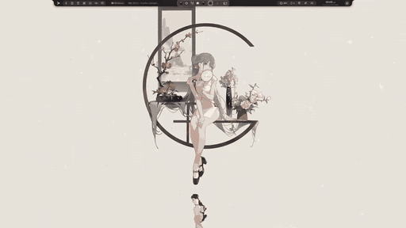

# Accretion Atlas

Explore your notes as stars orbiting a black hole. An Obsidian plugin that draws your vault as a 3D galaxy: notes are stars, their headings smaller stars around them, folders become clusters with their own nebula, and links are the lines between them.



[Download the 19-second demo (720p MP4, 1.7 MB)](https://raw.githubusercontent.com/7azu/accretion-atlas/main/media/accretion-atlas.mp4)

- [What it shows](#what-it-shows)
- [Controls](#controls)
- [Dashboard](#dashboard)
- [Settings](#settings): [colors](#colors), [clusters](#clusters), [tasks](#tasks), [desktop launcher](#desktop-launcher)
- [How it is drawn](#how-it-is-drawn)
- [Install](#install)
- [Build](#build)

## What it shows

- **Global galaxy.** Every note is a star. Headings of level 1 to 3 are smaller stars, joined to their note in the order of the document like a constellation. Linked attachments are faint points. Notes are grouped into clusters by folder; notes at the vault root share a cluster of their own.
- **Local galaxy.** The active note sits in the middle, its sections circle it, and the notes it links to lie further out, up to two steps away. It follows the note you have open.
- **Preview.** Hover over a star to see the title at once and, after a moment, the start of the note or section.
- **Dashboard.** Search, activity, tasks and the vault in numbers on one sheet over the galaxy.

Open the galaxy from the ribbon, or run **Open global galaxy** or **Open local galaxy** from the command palette. The local galaxy opens in the right sidebar. **Open dashboard** opens the global galaxy with its dashboard; give it a hotkey to get there from anywhere.

## Controls

| Action | Result |
| --- | --- |
| Drag, scroll | Rotate, zoom |
| Click a star | Open the note or heading (`Ctrl` + click: in a new tab) |
| Double-click a star | Fly to it |
| Click a cluster name | Fly into the cluster |
| Hover over a cluster name | Light its cluster and dim the others |
| Hover over a star | Title, then a preview |
| Click the black hole | Back to the starting view |
| **Dashboard** in the bar at the bottom, `Tab` or `/` | Open the dashboard |
| **Local** / **Global** at the top right | Switch between the two views |
| Bar at the bottom | Dashboard, zoom, reset the view, pause the motion, full screen |
| Arrow keys, `+` / `-`, `Space` | Turn the view, zoom, pause the motion |
| `Esc` | In the dashboard: empty the search, then close it. In the galaxy: back to the starting view |

With [tasks](#tasks) turned on, the bar at the bottom gets a button that shows only open tasks. A counter then appears at the top; click it to fly to the next one.

## Dashboard

The dashboard is a sheet over the whole view, with the galaxy blurred behind it. It scales with the window, so a large window shows it large. Open it with **Dashboard** in the bar at the bottom, with `Tab` or `/` while the galaxy has the keyboard, or by clicking the news under the greeting. The search has the keyboard right away.

- **Search** across note names, headings and the text of your notes. Arrow keys and `Enter` work; choosing a result opens the note and flies to its star.
- **Activity** of the last 12 weeks as a ring. Each bar is a day and shows how many notes you edited; an inner dot marks new notes. Beside it are the notes you edited last. Select a day on the ring to list its notes instead.
- **Tasks**, when turned on: how many are overdue, open and partly done, and what is due next. **Show in galaxy** leaves only the open tasks lit.
- **Most connected** notes.
- **Vault**: notes, ideas (the headings of your notes, at least one per note) and links, counted.
- **Clusters** by size. Click one to fly there.

Whatever leads into the galaxy or to a note closes the dashboard. The swatches at the bottom right set its accent, which is also the color of the ring.

## Settings

Everything is under **Settings → Accretion Atlas**.

### Your name

The galaxy and the dashboard greet you by name. Without a name here they use the name of your user account on this computer.

### Colors

By default the galaxy uses your Obsidian theme. **Use pywal colors** reads RGB triplets from the CSS variables `--ctp-accent` and `--wal-graph-1` through `--wal-graph-7`; enable your pywal CSS snippet in Obsidian so these variables exist. Changes apply to open views.

With pywal colors off, all nebulae share one muted gray, which you can change under **Nebula color**. With them on, each cluster's nebula takes its pywal color.

### Clusters

Each top-level folder is one cluster. To split a folder into several clusters, name the deeper folders under **Cluster folders**, one pattern per line. `*` stands for any folder name:

```
School/Year */*
Projects/*
```

The first line makes every subject folder of every year a cluster, the second every folder inside `Projects`. The first pattern that fits a note wins, so put the deeper ones first.

### Tasks

Off by default. With **Show tasks**, notes that carry a state in their properties become tasks:

```yaml
---
status: open
due: 2026-12-01
---
```

- Open tasks get their own color in the galaxy, and overdue ones pulse.
- The preview of a star shows its state and due date.
- A button in the bar at the bottom shows only open tasks.
- The greeting and the dashboard list what is due next.

The names of the properties and the values that mean open, partly done and done are set in the settings, so your existing notes do not need to change. An optional label property, such as a subject or project, is put in front of the title in the list of what is due next.

### Desktop launcher

Linux only, off by default. **Add the galaxy to the app launcher** writes an entry "Galaxy" that opens this vault's galaxy as a window of its own, without Obsidian's sidebars and tabs.

- Clicking a note turns the same window back into regular Obsidian, opening from the star you clicked. The book button in the bar at the bottom does the same without choosing a note.
- Starting "Galaxy" again brings the galaxy back.
- With [Quickshell](https://quickshell.org) and Hyprland, a loading screen covers the start of Obsidian and opens from the black hole once the galaxy is drawn. Without them the entry simply opens the galaxy.
- Turning the setting off removes the entry again.

The plugin writes the launcher's files into its own folder inside the vault and one desktop entry into `~/.local/share/applications`.

## How it is drawn

- **Black hole.** For every pixel a ray of light is traced through the Schwarzschild field. That gives the shadow, the photon ring and the image of the far side of the disk bent over the shadow. The disk is thin glowing gas whose strands rotate at Kepler speeds, brighter on the side moving towards you.
- **Gravitational lens.** Stars and dust behind the hole are pushed outwards and stretched into arcs, and a second pass draws their counter-image.
- **Orbits.** Dust and comets follow Kepler orbits; of a comet you see only a short fading tail.
- **Layout.** The stars fill a sphere around the hole. Each cluster gets a cone of that sphere, sized by how much it holds, and its stars spread inside it.
- **Depth.** Each cluster has layers of smoke where its stars are. Stars, dust and lines soften in front of and behind the plane of focus and dim with distance.

## Install

Requires desktop Obsidian 1.5.0 or newer and WebGL 2.

Download `main.js`, `manifest.json` and `styles.css` from the [latest release](https://github.com/7azu/accretion-atlas/releases/latest), put them into `<vault>/.obsidian/plugins/accretion-atlas/`, reload Obsidian and enable **Accretion Atlas** under Community plugins.

## Build

```sh
npm ci
npm run build
```

The plugin is built into `dist/`. `./install.sh <vault>` copies it into a vault; settings already there are left alone.

A release is built and published by the workflow in `.github/workflows/release.yml` when a branch `release/<version>` is pushed whose version matches `manifest.json`. The build embeds the license notices of Three.js and the D3 libraries in the JavaScript bundle.

## Credits

The accretion disk shader adapts plasma and column integration from [second-brain-black-hole](https://github.com/williamwasen/second-brain-black-hole). Its MIT license is included in the distributed plugin.
